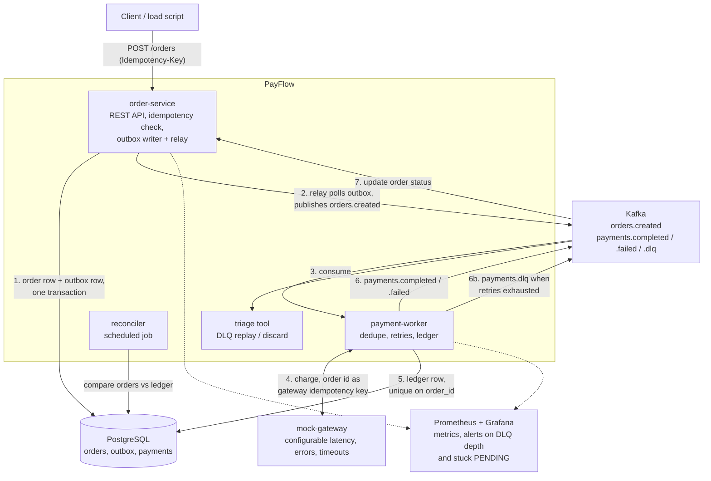

# Component Diagram

Ownership: the Java developer owns the four services; the DevOps developer owns PostgreSQL, Kafka and the observability stack as running infrastructure. See [ARCHITECTURE.md](../ARCHITECTURE.md#services).
