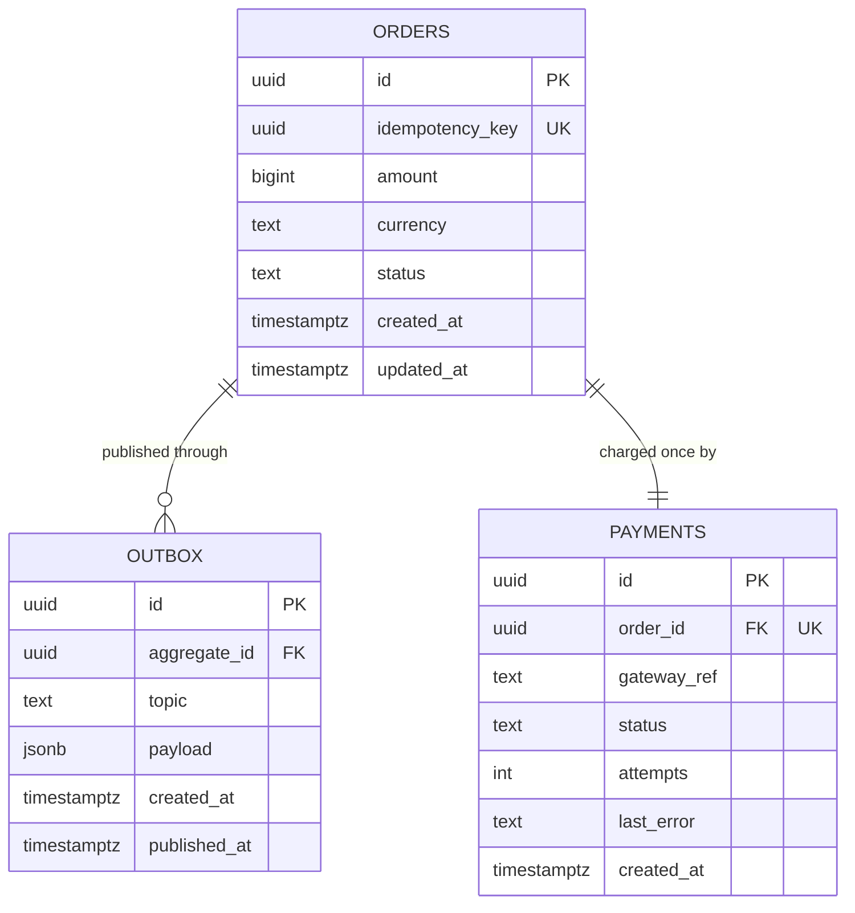

# Entity-Relationship Diagram

- `orders.idempotency_key` is unique: one API-level request produces one order ([ADR 0002](../adr/adr_0002-idempotency-keys-and-db-constraints.md)).
- `outbox.aggregate_id` points at the order; unpublished rows (`published_at IS NULL`) are what the relay polls ([ADR 0001](../adr/adr_0001-outbox-over-dual-write.md)).
- `payments.order_id` is unique: one order is charged at most once, however many times the event is redelivered.

Amounts are stored in the smallest currency unit (see [API.md](../API.md)).
