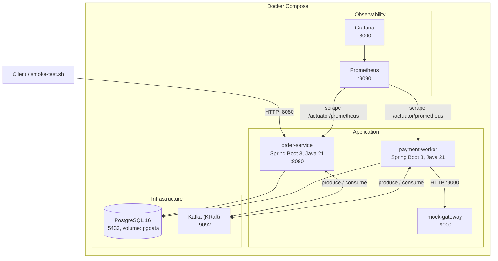

# Deployment Diagram (local target state)

Everything runs locally through `docker compose up -d`; no cloud resources and no spend. Kubernetes manifests come in week 4 and mirror this layout one pod per service. Exact images, ports and credentials live in `compose.yml` and `.env.example` once the platform work lands; this diagram tracks [ARCHITECTURE.md](../ARCHITECTURE.md#platform-and-security).
