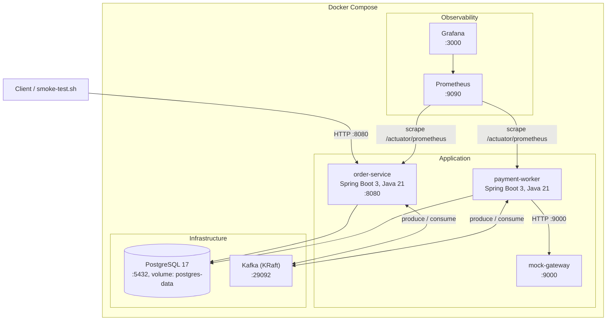

# Deployment Diagram (local target state)

Everything runs locally through `docker compose up -d`; no cloud resources and no spend. The infrastructure and observability containers above already run from `compose.yml`; the application containers join it as their images land (see `ops/java/Dockerfile`). Kubernetes manifests under `ops/kubernetes/` mirror this layout one pod per service. Exact images and ports live in `compose.yml`; this diagram tracks [ARCHITECTURE.md](../ARCHITECTURE.md#platform-and-security).
