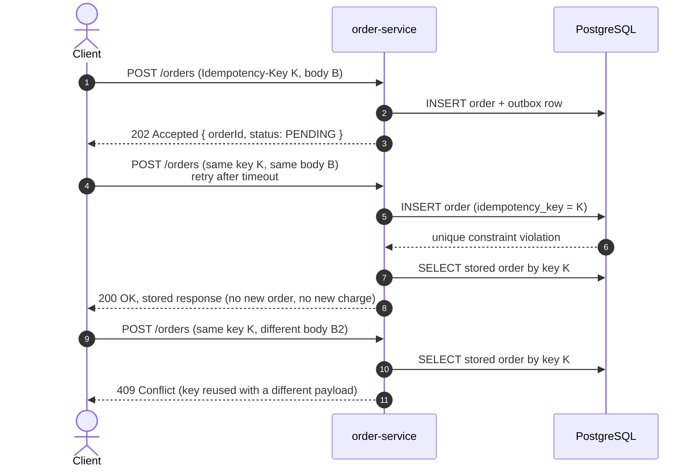

# Sequence: Duplicate and Concurrent Requests

Concurrent duplicates race on the unique constraint: one transaction wins, the losers read the winner's row and return the stored response. The database constraint, not an in-memory check, is the source of truth ([ADR 0002](../adr/adr_0002-idempotency-keys-and-db-constraints.md)).
