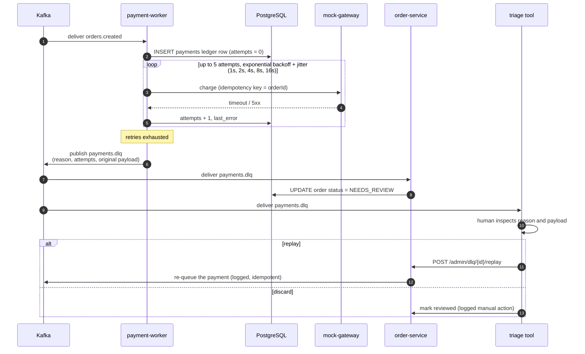

# Sequence: Gateway Failure, Retries and the DLQ

A permanent gateway error takes the same path but publishes `payments.failed` instead, and the order becomes `FAILED` without entering the DLQ. See [FAILURE_SCENARIOS.md](../FAILURE_SCENARIOS.md) scenarios 7-9.
