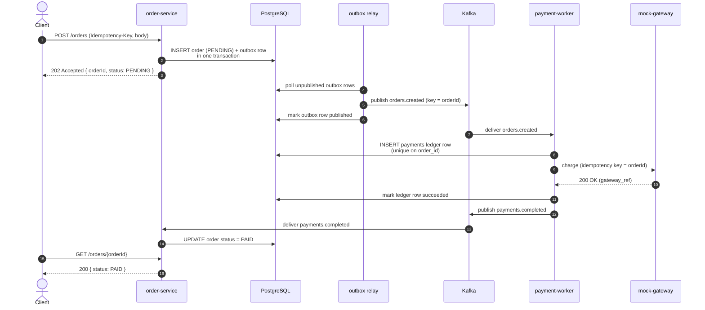

# Sequence: Happy Path (order to PAID)

The order reaches a single terminal state (`PAID`) with exactly one charge. Every step after the first is asynchronous; the client learns the result through `GET /orders/{orderId}`.
